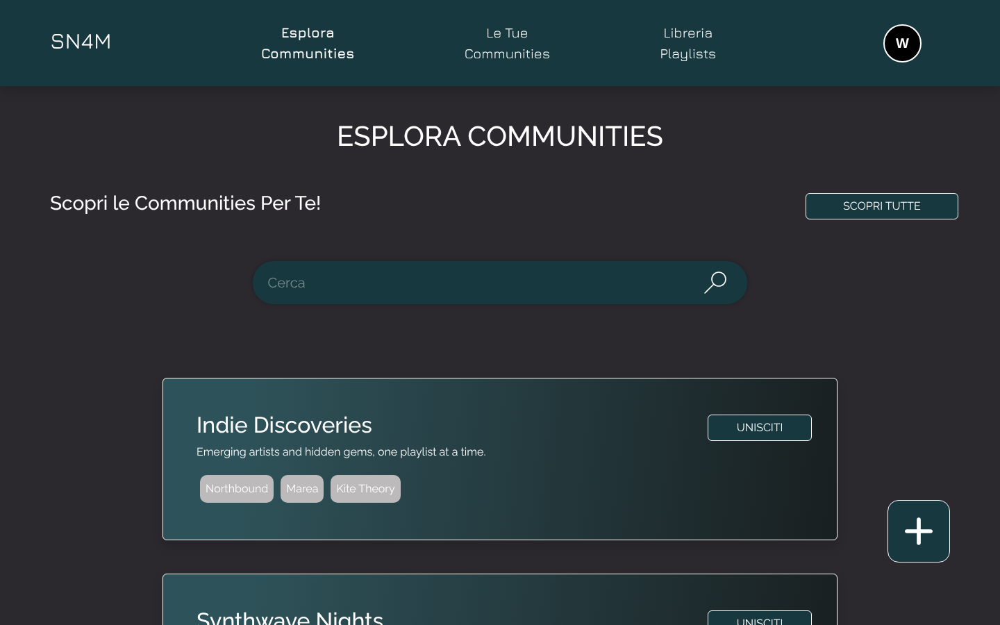
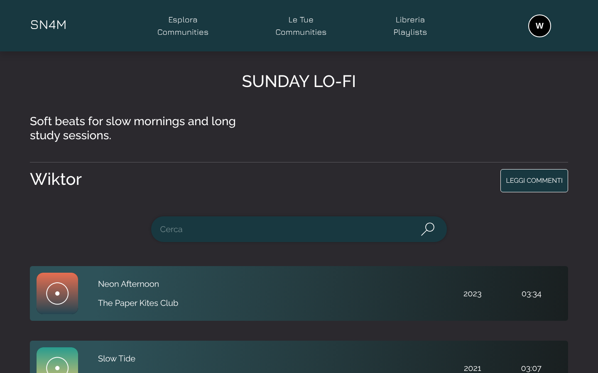
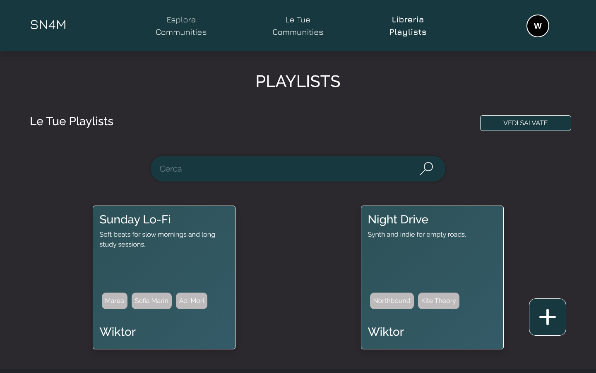
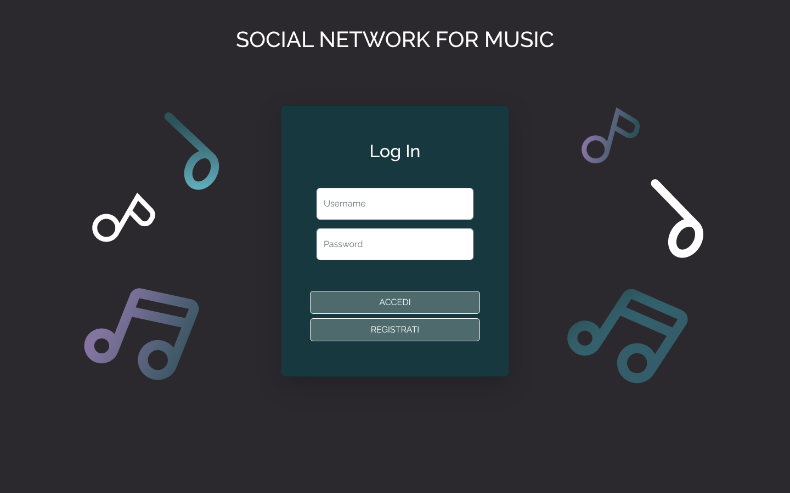

# SN4M · Social Network for Music

**A web app for sharing music playlists inside communities of people with similar taste.**

Users build playlists with tracks searched through the Spotify Web API, create or join communities around their favourite artists, share playlists there and discuss them in the comments. Communities are suggested based on the artists in each user's profile.

**Live demo:** [sn4m.vercel.app](https://sn4m.vercel.app)


<p align="center">
  
  
  
  
</p>

<sub>Screenshots with sample data and fictional tracks.</sub>

---

## Features

- **Accounts.** Sign up with email, username, password and 3 to 15 favourite artists (searched on Spotify); log in, edit or delete the profile.
- **Playlists.** Create, edit and delete playlists with a title, description and artist tags; search Spotify tracks and add or remove them; save other people's playlists to your library.
- **Communities.** Create a community around a set of artists, edit it, join or leave others, and see the ones you created separately from the ones you follow.
- **Suggestions.** "Communities for you" recommends communities whose tags match at least 55% of your favourite artists; "Discover all" shows every community you haven't joined yet.
- **Sharing and comments.** Share your playlists inside a community, browse what others shared, comment (10–150 characters), edit your comments and filter to see only yours.
- **Search everywhere.** Live search bar on communities, playlists and tracks.
- **Feedback.** Inline form validation and toast notifications.

## Tech stack

| Area | Choice |
|---|---|
| UI | React 19 (Create React App), React Router 7 |
| Styling | Bootstrap 5, Bootstrap Icons, custom Sass theme |
| Notifications | react-toastify |
| Music data | Spotify Web API (track and artist search, track details) |
| Persistence | Browser `localStorage` (users, playlists, communities) and `sessionStorage` (login session) |
| Hosting | Vercel |

There is no backend: all data lives in the browser, which keeps the project self-contained and easy to deploy as a static site.

## Getting started

**Requirements:** Node.js 18 or newer and a free app on the [Spotify Developer Dashboard](https://developer.spotify.com/dashboard) (for the Client ID and Client Secret).

```bash
git clone https://github.com/WiktorVerga/SN4M.git
cd SN4M/sn4m
npm install
```

Create a `.env` file in `sn4m/` with your Spotify credentials:

```env
REACT_APP_CLIENT_ID=your_spotify_client_id
REACT_APP_CLIENT_SECRET=your_spotify_client_secret
```

Then start the app:

```bash
npm start        # development server on http://localhost:3000
npm run build    # production build in sn4m/build
```

On Vercel, set the project root to `sn4m` and add the two variables in the project settings.

## Project structure

```
sn4m/src/
├─ App.js            Routes and session check
├─ pages/
│  ├─ user/          Login, Sign-in, User profile
│  ├─ communities/   Explore, Your communities, Community, Create / Edit
│  └─ playlist/      Library, Playlist, Add songs, Shared playlist, Comments, Create / Edit
├─ Components/       Navbar, cards (community, playlist, song, comment), tags, search bar
├─ utilities/        Spotify token and requests, localStorage helpers for users, playlists, communities
├─ media/            Icons and illustrations
└─ index.scss        Theme
```

## Known limitations

- **Client-side credentials.** The Spotify token is requested from the browser with the Client Credentials flow, so the Client Secret ends up in the JavaScript bundle. A real deployment should move the token request to a small serverless function.
- **Local-only data.** Accounts and passwords are stored in plain text in `localStorage`, so data is per browser and not shared between users on different devices. A database and proper authentication would be the next step.

## Context

University project for the course [Applicazioni Web e Cloud](https://www.unimi.it/it/corsi/insegnamenti-dei-corsi-di-laurea/2025/applicazioni-web-e-cloud) (Web and Cloud Applications), BSc in Computer Science for Digital Communication, [Università degli Studi di Milano](https://www.unimi.it/it), academic year 2024/25. Lecturers: Claudio Agostino Ardagna, Valerio Bellandi.

## Author

**Wiktor Verga** · [GitHub](https://github.com/WiktorVerga) · [LinkedIn](https://linkedin.com/in/wiktor-verga)
